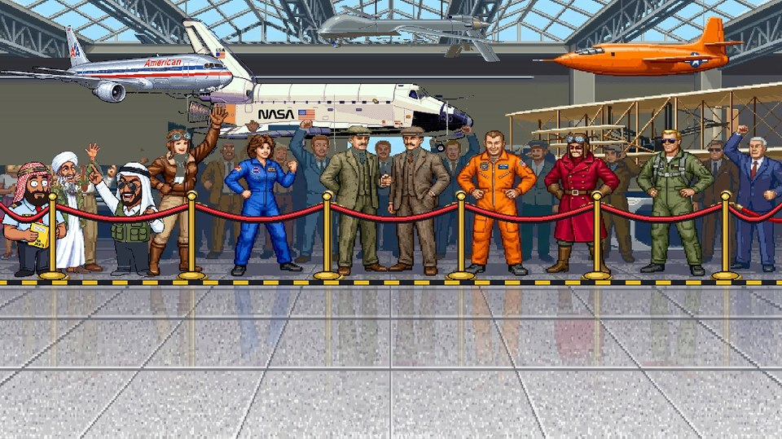
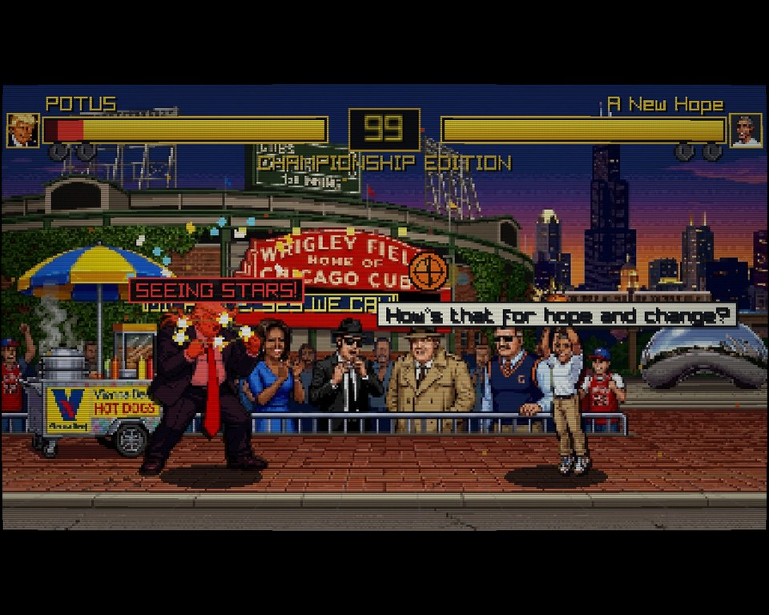
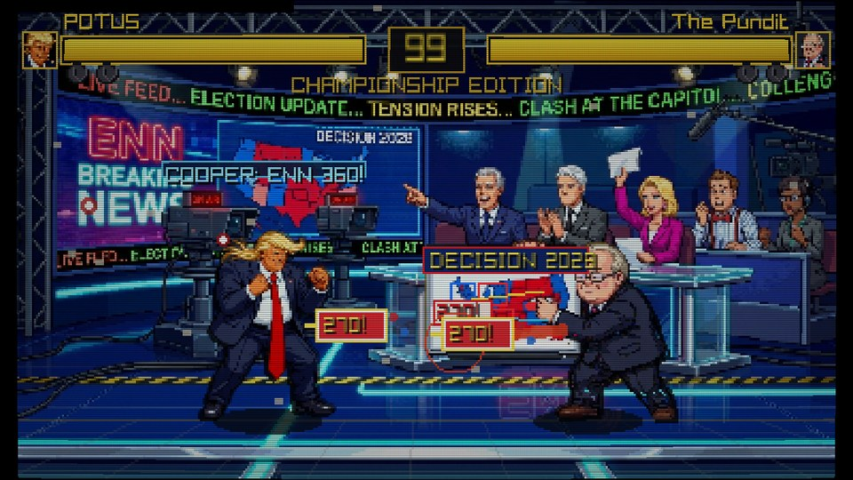
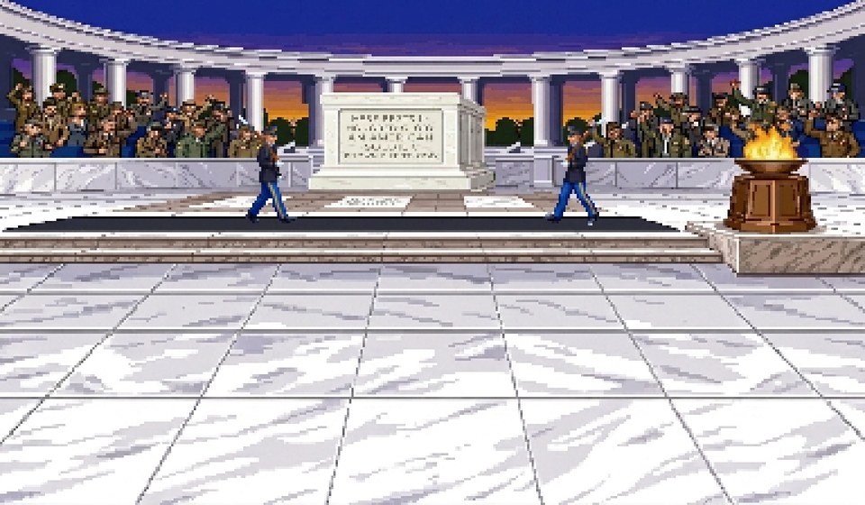

# Executive Order II: Total Veto (Championship Edition)

**Executive Order II: Total Veto — Championship Edition** is a 16-bit arcade-style 2D satirical political fighting game inspired by classic 1990s coin-op brawlers.

## Download

- **[Download Championship Edition (Windows `.zip`)](https://github.com/andarazoroflove/ExecutiveOrder/releases/latest)**

Extract `ExecutiveOrderCE.zip` and run `ExecutiveOrderCE.exe`. All assets and audio are self-contained.

---

## Screenshots

| Character & Stage Select | Smithsonian Air & Space |
| :---: | :---: |
|  |  |

| Chicago Wrigleyville | ENN Broadcast Studio |
| :---: | :---: |
|  |  |

| Tomb of the Unknown Soldier |
| :---: |
|  |

---

## Basic Controls

Supports both **Keyboard** and **Gamepad** (Xbox / PlayStation / SDL controllers).

| Action | Keyboard | Gamepad |
| :--- | :--- | :--- |
| **Move / Jump / Crouch** | `W` `A` `S` `D` or Arrow Keys | D-Pad / Left Stick |
| **Light Punch** | `U` or `Z` | `X` / Square |
| **Heavy Punch** | `I` or `X` | `Y` / Triangle |
| **Light Kick** | `J` or `C` | `A` / Cross |
| **Heavy Kick** | `K` or `V` | `B` / Circle |
| **Signature Special** | `O` or `E` | `RB` / `RT` |
| **Taunt** | `Y` or `Q` | `LB` / `LT` |
| **Start / Pause** | `Enter` | `Start` |
| **Fullscreen Toggle** | `F11` or `Alt+Enter` | — |
| **CRT Filter Toggle** | `F1` / `F2` | — |
| **Exit** | `Esc` | `Select` |
