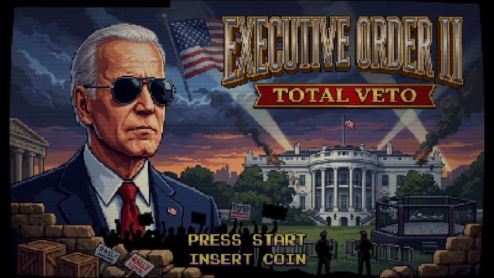
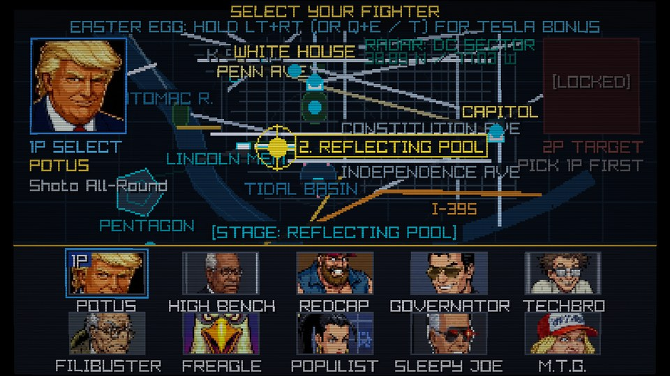
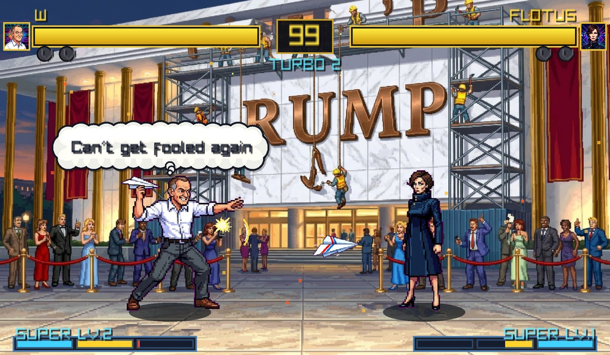
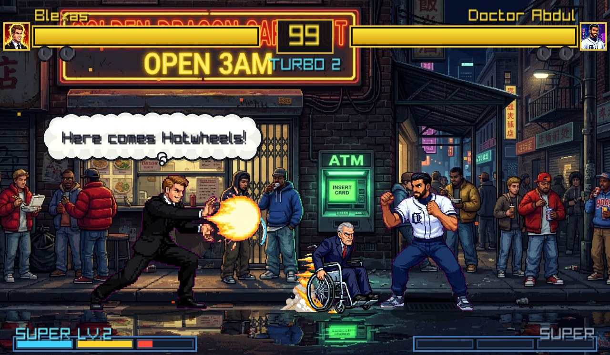
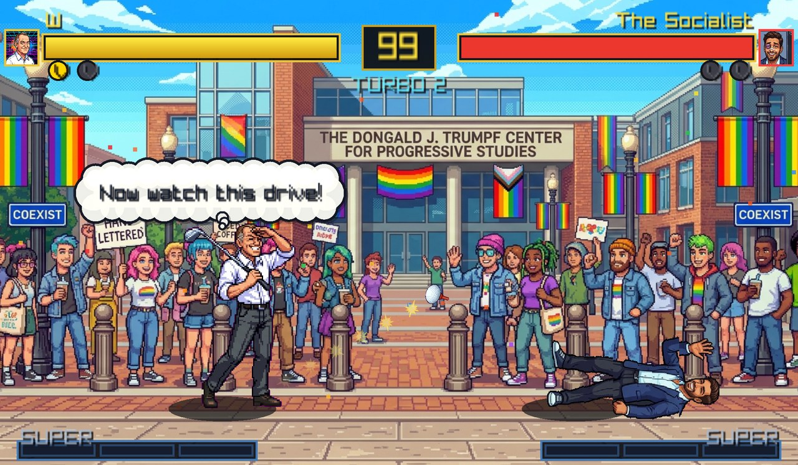
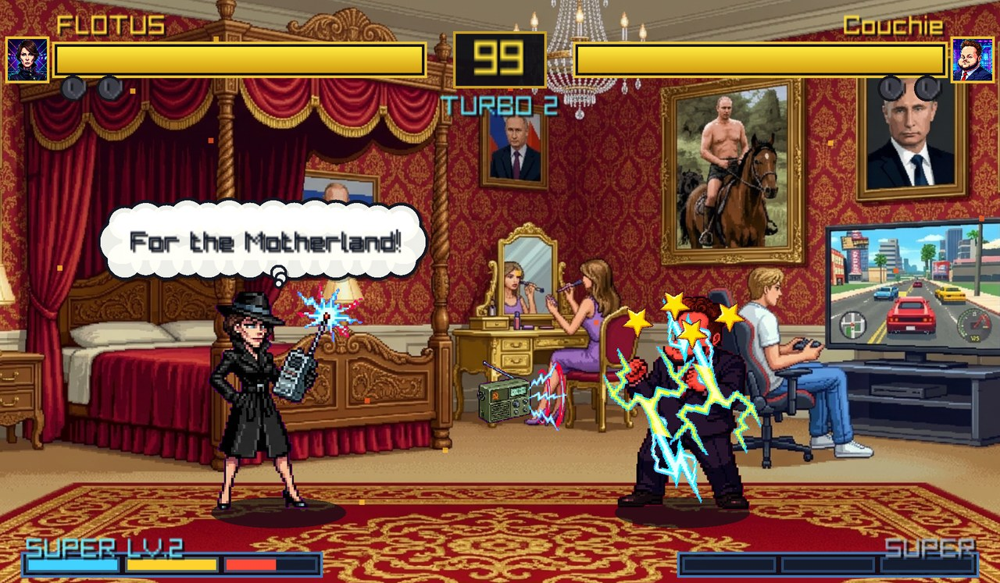
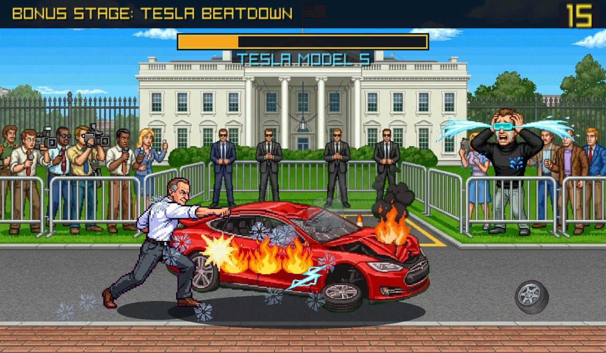
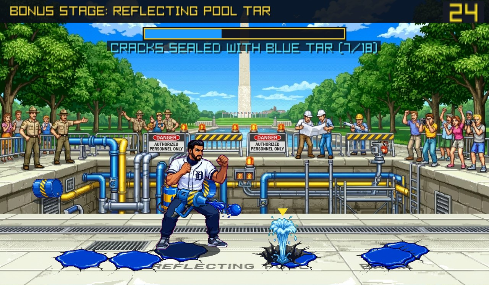
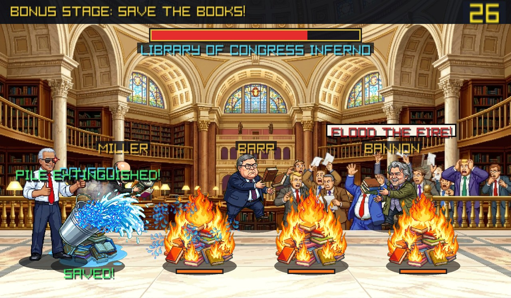
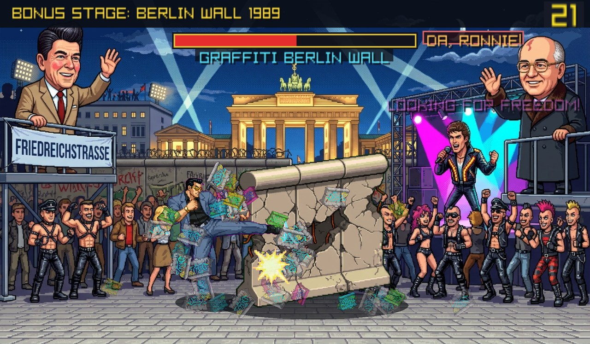

# Executive Veto II Turbo: Global Conflict

**Executive Veto II Turbo: Global Conflict (`2.0-bluewave`)** is an HD 16-bit arcade-style 2D satirical political fighting game inspired by classic 1990s coin-op brawlers — featuring an expanded roster, new Washington D.C. & global arenas, arcade bonus stages, and a full stereo cyberpunk / trip-hop / guitar-riff soundtrack.

## Download

- **[Download Executive Veto II Turbo `2.0-bluewave` (Windows `.zip`)](https://github.com/andarazoroflove/ExecutiveOrder/releases/tag/2.0-bluewave)**
- **[Direct `.zip` Download (`ExecutiveVetoII-Turbo.zip`)](https://github.com/andarazoroflove/ExecutiveOrder/releases/download/2.0-bluewave/ExecutiveVetoII-Turbo.zip)**

Extract `ExecutiveVetoII-Turbo.zip` and run `ExecutiveVetoII-Turbo.exe`. All HD graphics, voice lines, and stereo audio are 100% self-contained.

---

## Screenshots

| Character & Stage Select | Performing Arts Center |
| :---: | :---: |
|  |  |

| The Hood | Progress Avenue |
| :---: | :---: |
|  |  |

| The Lincoln Bedroom | Tesla Beatdown Bonus |
| :---: | :---: |
|  |  |

| Reflecting Pool Repair Bonus | Library of Congress Bonus |
| :---: | :---: |
|  |  |

| Berlin Wall 1989 Bonus |
| :---: |
|  |

---

## Basic Controls

Supports both **Keyboard** and **Gamepad** (Xbox / PlayStation / XInput / SDL controllers).

| Action | Keyboard | Gamepad |
| :--- | :--- | :--- |
| **Move / Jump / Crouch** | `W` `A` `S` `D` or Arrow Keys | D-Pad / Left Stick |
| **Light Punch** | `U` or `Z` | `X` / Square |
| **Heavy Punch** | `I` or `X` | `Y` / Triangle |
| **Light Kick** | `J` or `C` | `A` / Cross |
| **Heavy Kick** | `K` or `V` | `B` / Circle |
| **Signature Special** | `O` or `E` | `RT` / `R2` |
| **Block** | Hold Back, `L`, or `Shift` | Hold Back or `LT` / `L2` |
| **Taunt** | `Y` or `Q` | `LB` / `L1` |
| **Turbo Speed** | `Tab` | `Select` (Title / Select) |
| **Start / Pause** | `Enter` | `Start` |
| **Fullscreen Toggle** | `F11` or `Alt+Enter` | — |
| **CRT Filter Toggle** | `F1` / `F2` | `R3` |
| **Exit** | `Esc` | `Select + Start` |
